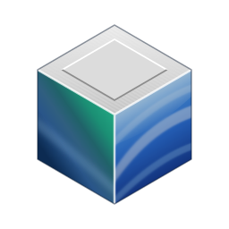
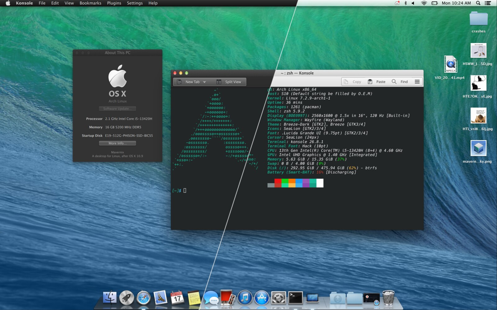

<p align="center">
  
</p>

<h1 align="center">Mavernix</h1>

<p align="center">
  <b>Turns your desktop more… lickable.</b><br>
  <a href="docs/building.md">Install</a> · <a href="docs/usage.md">Use</a> · <a href="docs/themes/README.md">Themes</a> · <a href="CONTRIBUTING.md">Contribute</a>
</p>

<p align="center">
  <a href="https://discord.gg/9JC4cWKzjT"></a>
</p>

Mavernix is a Linux desktop with a menu bar up top, a dock down below, and windows that cast real shadows. Under the hood it's built on [Wayfire](https://github.com/WayfireWM/wayfire) and [Quickshell](https://quickshell.org).

On a fresh install it looks pretty plain, and that's on purpose. The fun starts if you've still got an old installer for a classic system somewhere. Hand it to the Theme Installer and it builds the whole look right on your machine:

| Your installer | Turns into | Status |
|---|---|---|
| OS X 10.9.5 Mavericks | Sea Lion, light and dark | supported |
| Mac OS X 10.3 Panther | | soon |
| Mac OS 9 | | maybe.. |

Mavernix doesn't ship any of Apple's files. Every look is built from your own copy of the installer.

<p align="center">
  
</p>

## Install

Mavernix is built and tested on Arch Linux. It is in the AUR as [`mavernix`](https://aur.archlinux.org/packages/mavernix):

```sh
yay -S mavernix
```

Then pick Mavernix on your login screen. Want to build it yourself? See [docs/building.md](docs/building.md).

Just want to look around first? `dev/run-in-container` runs it in a Podman container, no install needed.

## Contributing

Bug reports, themes and docs fixes are all welcome, and you don't need to know any C++. See [CONTRIBUTING.md](CONTRIBUTING.md).

## Docs

[Usage](docs/usage.md) · [Configuration](docs/configuration.md) · [Themes](docs/themes/README.md) · [Looks](docs/looks.md) · [Panel items](docs/panel-items.md) · [Extensions](docs/extensions.md) · [App Store](docs/app-store.md) · [Sound packs](docs/sound-packs.md) · [Architecture](docs/architecture.md)

## License

GPL-3.0-or-later, see [LICENSE](LICENSE). Two compositor plugins are based on Wayfire's and keep its MIT license too (`src/compositor/*/LICENSE-wayfire`).

Mavernix is not affiliated with or endorsed by Apple Inc. Mac and OS X are trademarks of Apple Inc.
